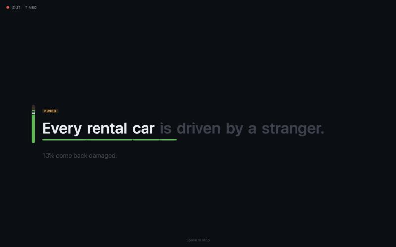
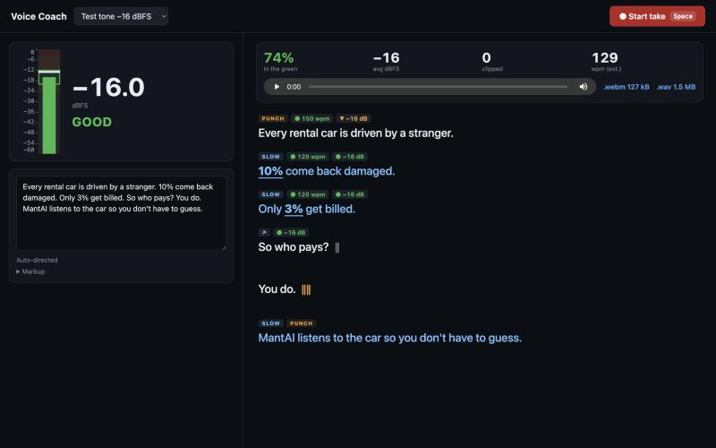

# Voice Coach

A local recording studio for short-form video voiceovers. You write the script, and it is directed automatically: pace, energy, pauses and emphasis for every line. While you record, the screen shows one line at a time and coaches you with visual signals instead of instructions. Afterwards you pick the best take by its numbers and download it with a timing file that says where every line is.

| Recording: one line, three signals | After the take: line-by-line review |
|---|---|
|  |  |

## Run

```bash
npm install
npm run dev
```

Open the printed `http://localhost:…` URL in **Chrome on macOS** and allow microphone access.

```bash
npm test        # unit tests (Vitest)
npm run build   # type-check + production build
npm run lint    # oxlint
```

### Optional: Refine with Claude

Copy `.env.example` to `.env` and set `ANTHROPIC_API_KEY=…`. A **Refine with Claude** button then appears under the script.

The key is read only by the Vite dev server, which proxies `POST /api/direct` to the Claude API. It is never sent to the browser. If the call fails or returns invalid JSON, the app falls back to the built-in heuristics and says so.

## Microphone

Pick your mic in the **Mic** menu above the level meter. Mic names appear once you have allowed microphone access (click **Turn on input**). The choice is remembered: next time the app reopens that mic, matching it by device id and then by name. If it isn't plugged in, the app uses the system default and says so, then switches back when you plug it in. If the open mic disappears, it falls back to the default.

Gain is stored **per mic**, because a level check on one mic is wrong for another. A mic you haven't checked yet starts at 0 dB, with a hint to run **Check level**. USB mics often need it: a Shure MVX2U, for example, reads about −32 dBFS on a normal read, far below the green.

Chrome's speech recognition doesn't let a page choose the mic, so it may listen to Chrome's default microphone (set in `chrome://settings/content/microphone`) rather than the one picked here. The picker sets what is metered and recorded.

## Levels: what the numbers mean

Levels are in **dBFS** (decibels relative to digital full scale, where 0 is the loudest possible sample). They are **not dB SPL**: a browser can't measure real-world loudness without a calibrated mic.

| Measure | How |
|---|---|
| RMS level (big number, zones, status) | mean-square power, smoothed with a ~300 ms moving average |
| Sample peak | loudest sample per frame; the peak-hold marker sticks for 1.5 s |

Zones for the **normal** target (the standard voiceover range):

| RMS dBFS | Zone | Status |
|---|---|---|
| below −24 | too quiet (grey) | LOUDER |
| −24 to −20 | approaching (yellow) | LOUDER |
| **−20 to −12** | **good (green)** | **GOOD** |
| above −12 | hot (amber) | BACK OFF |
| any peak above −3 | red | BACK OFF |

Unprocessed speech peaks sit roughly 12–18 dB above its RMS level, so red is reserved for **near clipping (peaks above −3 dBFS)**. A red at −6 would flash on every good take. A sample at or above **−1 dBFS** counts as a clipped peak.

While recording, the green band moves to match each line's energy target:

| Energy | Green band (RMS dBFS) |
|---|---|
| soft | −26 to −18 |
| normal | −20 to −12 |
| punch | −16 to −9 |

### Check level (do this once per mic)

Built-in laptop mics with the audio filters off read about 20–25 dB below voiceover level, which would leave you permanently in "LOUDER". **Check level** takes 8 seconds: 3 s of silence (noise floor), then 5 s of you reading the first line. It then sets a digital input gain so your normal read averages about **−18 dBFS**, while keeping 95% of peaks under −3 dBFS. The gain applies to the meter and the recording, and is remembered in this browser for that mic. Test sources always run at 0 dB gain.

A noise floor above **−50 dBFS** (after gain) means the room is too noisy for clean takes. During a take, any frame within 6 dB of the floor counts as silence and is left out of the summary.

The mic is opened with echo cancellation, noise suppression and auto-gain **off**, because those filters distort level readings.

## Directing

The script is directed **as you type** (no button). It splits the script into sentences (and splits sentences over 20 words at `;` and `—`). It gives each segment:

- a pace: slow 120 / normal 150 / fast 180 wpm (blue / white / orange)
- an energy level: soft / normal / punch
- a pause after it: short 0.3 s `‖` / long 0.8 s `‖‖`
- emphasis words, shown in **bold**

Auto rules apply in this order. Later rules win, the longer pause always wins, and manual markup overrides everything:

1. lists (3+ comma-separated items) and setup lines → fast
2. numbers, %, $ → slow, with the number (and its unit) emphasised
3. questions → rising tone (↗) + short pause
4. hook (first line) → punch, normal pace
5. the line before the CTA → long pause
6. last line / CTA → slow + punch

### Markup

| Markup | Effect |
|---|---|
| `[slow]…[/slow]` `[fast]…[/fast]` | force pace |
| `[loud]…[/loud]` `[soft]…[/soft]` | force energy (loud = punch) |
| `*word*` or `*several words*` | emphasis |
| `/` | short pause (0.3 s) |
| `//` | long pause (0.8 s) |

Example: `[fast]Cars, vans, trucks[/fast] // *all* of them.`

## Recording: one line, three signals

Press **Space** (or **● Start take**). After a 3-2-1 countdown the screen shows only the current line, with the previous and next lines dimmed. You get no text instructions while recording, only signals:

| Signal | Meaning |
|---|---|
| Words light up | where you are: each word turns bright as speech recognition hears it |
| Bar under the words | where the target pace says you should be. **Green**: on pace · **blue**: you're rushing (ahead of the bar) · **amber**: you're dragging (behind it) |
| Draining ring before a line | hold the pause (0.3 s or 0.8 s) until it empties |
| Slim bar left of the line | your level against this line's target band (soft / normal / punch). Green = inside the bracket |

How following works:

- Speech recognition starts during the countdown, so your first words aren't lost while it warms up.
- Each recognised word is matched to the nearest script word ahead. Matching is fuzzy for longer words ("damage" ≈ "damaged", "build" ≈ "billed") and number words map to digits ("ten" = "10%").
- If words are missed or mangled (brand names often are), two consecutive matching words up to 40 words ahead put the prompter back on track.
- The pace bar starts each line when you say its first word. It carries over from the previous line, so starting a line early or cutting a pause short still shows as rushing; starting late is forgiven.
- A pace colour has to hold for 0.5 s before it shows, so recognition bursts don't make it flicker.
- The take stops by itself 1.5 s after the last word, or press **Space**.
- **R** restarts following from the top within the same recording. The timing export then uses the last pass.

If speech recognition isn't available or is blocked, the prompter falls back to **timed** scrolling at the target pace.

⚠️ Chrome's speech recognition sends audio to Google's servers. The level meter and the recordings themselves stay local.

## After the take: pick by the numbers

Record the voice first, **3 takes at most**, then pick by the numbers and finally by ear. The app suggests three but doesn't stop you. Every take of the session is listed:

| Column | What it is |
|---|---|
| Length | duration of the recording |
| Loudness | integrated loudness in LUFS (ITU-R BS.1770-4: K-weighting, 400 ms blocks, −70 LUFS absolute and −10 LU relative gates), measured on the recorded file |
| Noise floor | the quietest 10% of 50 ms windows, dBFS RMS |
| In green | % of speaking time inside the target band |
| Clipped | peaks at or above −1 dBFS |
| Pace | average wpm over the words actually reached |

Click a take's number to see its line-by-line results below: pace (● on target, ▲ too fast, ▼ too slow; lines under 4 words aren't judged) and level against that line's band (● good, ▼ quiet, ▲ hot). **▶** plays the take.

Loudness is measured on the file as recorded. Browsers record a mono mic as two identical channels, which BS.1770 reads 3 dB louder than the same voice in a mono file. The number matches what `ffmpeg -af ebur128` reports for the downloaded `.wav`.

### How the best take is chosen

The ★ goes to the best take by these rules (from `src/lib/takes.ts`):

1. **It qualifies** when it has no clipped peaks, a noise floor at or below −50 dBFS, integrated loudness within ±6 LU of **−16 LUFS** (the level the edit pipeline normalises to), and it reached at least 90% of the script.
2. Of the qualifying takes, the one with **the most time in the green** wins.
3. Takes within 5 points of that are a tie, won by the loudness **closest to −16 LUFS**. A take that needs less gain brings up less room noise.

A take that fails says why, for example "too quiet · noisy". If none qualifies, nothing gets a star. Then listen: the numbers can't hear a flubbed word.

### Downloads

Each take downloads under one base name, local date and time plus take number:

| File | What |
|---|---|
| `voice-coach_2026-10-09_14-03_take2.webm` | the recording (Opus) |
| `voice-coach_2026-10-09_14-03_take2.wav` | the same, 16-bit PCM, converted in the browser |
| `voice-coach_2026-10-09_14-03_take2.json` | timing: lines, word times, chunks, stats (see below) |
| `voice-coach_2026-10-09_14-03_take2.lines.json` | just the chunks, ready for `voice_assemble.py` |

### Shortcuts

| Key | Action |
|---|---|
| Space | start / stop a take |
| Esc | stop |
| R | restart following from the top |
| ↑ / ↓ | nudge the prompter (±1 word in speech mode, ±1 s in timed mode) |

Shortcuts are ignored while you type in the script box or use a menu. Space does nothing during **Check level**.

### Testing without a mic

The **Input** menu has test sources: tones at −30, −16 and −3 dBFS RMS, or any audio file. They go through the same meter and recorder as the mic.

## Timing export

The app already knows when the prompter reached each line and word. The timing file turns that into times **in the take's own seconds**, from the first sample of the recording, with the countdown left out (abridged):

```json
{
  "app": "voice-coach", "version": 1, "take": 2, "recordedAt": "2026-10-09T12:03:41.512Z",
  "durationSec": 17.58, "sampleRate": 48000,
  "script": "Every rental car is driven by a stranger. 10% come back damaged. …",
  "tracking": "speech",
  "lines": [
    { "index": 0, "text": "Every rental car is driven by a stranger.", "start": 0.6, "end": 3.44,
      "words": [ {"w": "Every", "t": 0.6}, {"w": "rental", "t": 1.02}, {"w": "car", "t": 1.5}, … ] },
    …
  ],
  "chunks": [
    [[0.6, 3.44]],
    [[3.9, 5.64]],
    …
    [[11.3, 13.04], [13.5, 15.64]]
  ],
  "stats": { "integratedLufs": -16.7, "noiseFloorDb": -57.2, "greenPct": 84, "avgDb": -17.3, "clippedPeaks": 0, "wpm": 151, "followedPct": 100 },
  "notes": []
}
```

How the times are found:

- Speech recognition delivers words a few hundred ms after you say them, often several at once. On its own that is too rough to cut audio, so the app also finds where you were speaking in the recorded audio (pauses of 0.18 s or more split speech) and **snaps each line boundary to the pause** that best fits the recognition times. A second pass corrects for how slow recognition was in this take. In simulated takes about 97–99% of lines get exactly the right chunks.
- `chunks` has one entry per script line, each a list of `[start, end]` pieces of speech. Pauses of 0.3 s or more inside a line split it into pieces.
- Word times (`t`) are estimates: each line's words spread over its speech by length. Good enough for captions and text pops, not a forced alignment.
- A line that was never reached gets an empty list and a note in `notes`. So does a line that couldn't be found in the audio. Lines read without any pause between them get an estimated split and a note. Timed mode (no speech recognition) is flagged, because its times follow the prompter's schedule.

## Part of a workflow

Voice Coach is the recording step of [ContentCreation](https://github.com/juanito-lab/ContentCreation), a Remotion pipeline for short vertical videos. Record the voice first, pick the take here, then let the pipeline clean it, level it to −16 LUFS, speed it up and cap the pauses:

```bash
# in the ContentCreation repo
python3 tools/voice_assemble.py voice-coach_2026-10-09_14-03_take2.wav vo.wav plan.json \
  voice-coach_2026-10-09_14-03_take2.lines.json 1.08
```

`voice_assemble.py` takes the raw take, the output file, a plan file it writes, then `lines.json`: a bare list with one entry per line. The `.lines.json` download is exactly that list (the `chunks` array of the timing file). The full `.json` won't work there, because its top level is an object; extract the list with `jq .chunks take2.json > lines.json` if you only kept that file. Edit `lines.json` by hand to drop a flubbed piece, or delete an empty entry before assembling (an empty entry only adds a short silence). The trailing `1.08` is the +8% tempo; see the script's header for the other options.

## Storage

The last script, any Claude direction for it, the mic you picked, and each mic's gain and noise floor are saved in `localStorage`. Takes live in memory only: download what you want to keep before you reload the page.

In dev, each take also posts a diagnostics line (tracking mode, words followed, per-line results) to the dev-server console. Nothing leaves your machine.

## License

MIT
