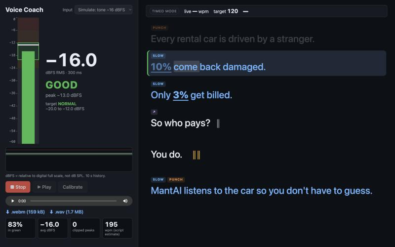

# Voice Coach

A local recording studio for short-form video voiceovers. It shows a live dBFS level meter on the left and an auto-directed teleprompter on the right that follows your pace while you record.



## Run

```bash
npm install
npm run dev
```

Open the printed `http://localhost:…` URL in **Chrome on macOS** and allow microphone access.

```bash
npm test        # unit tests (Vitest)
npm run build   # type-check + production build
```

### Optional: Direct with Claude

Copy `.env.example` to `.env` and set `ANTHROPIC_API_KEY=…`. A "Direct with Claude" toggle then appears.

The key is read only by the Vite dev server, which proxies `POST /api/direct` to the Claude API. It is never sent to the browser. If the call fails or returns invalid JSON, the app falls back to the built-in heuristics and says so.

## Levels: what the numbers mean

Levels are in **dBFS** (decibels relative to digital full scale, where 0 is the loudest possible sample). They are **not dB SPL**: a browser can't measure real-world loudness without a calibrated mic.

| Measure | How |
|---|---|
| RMS level (big number, zones, status) | mean-square power, smoothed with a ~300 ms moving average |
| Sample peak | loudest sample per frame; the peak-hold marker sticks for 1.5 s |

Zones for the **normal** target (the standard voiceover range):

| RMS dBFS | Zone | Status |
|---|---|---|
| below −24 | too quiet (grey) | LOUDER |
| −24 to −20 | approaching (yellow) | LOUDER |
| **−20 to −12** | **good (green)** | **GOOD** |
| above −12 | hot (amber) | BACK OFF |
| any peak above −6 | red flash | BACK OFF |

A sample at or above **−1 dBFS** counts as a clipped peak.

While recording, the green band moves to match each line's energy target:

| Energy | Green band (RMS dBFS) |
|---|---|
| soft | −26 to −18 |
| normal | −20 to −12 |
| punch | −16 to −9 |

**Calibrate** samples 3 s of room noise. A noise floor above **−50 dBFS** is too noisy. During a take, any frame within 6 dB of the floor counts as silence and is left out of the summary.

The mic is opened with echo cancellation, noise suppression and auto-gain **off**, because those filters distort level readings.

## Directing

**Direct it** splits the script into sentences (and splits sentences over 20 words at `;` and `—`). It gives each segment:

- a pace: slow 120 / normal 150 / fast 180 wpm (blue / white / orange)
- an energy level: soft / normal / punch
- a pause after it: short 0.3 s `‖` / long 0.8 s `‖‖`
- emphasis words, shown in **bold**

Auto rules apply in this order. Later rules win, the longer pause always wins, and manual markup overrides everything:

1. lists (3+ comma-separated items) and setup lines → fast
2. numbers, %, $ → slow, with the number (and its unit) emphasised
3. questions → rising tone (↗) + short pause
4. hook (first line) → punch, normal pace
5. the line before the CTA → long pause
6. last line / CTA → slow + punch

### Markup

| Markup | Effect |
|---|---|
| `[slow]…[/slow]` `[fast]…[/fast]` | force pace |
| `[loud]…[/loud]` `[soft]…[/soft]` | force energy (loud = punch) |
| `*word*` or `*several words*` | emphasis |
| `/` | short pause (0.3 s) |
| `//` | long pause (0.8 s) |

Example: `[fast]Cars, vans, trucks[/fast] // *all* of them.`

## Recording and follow-along

- **Record / Stop / Play**, then download the take as **.webm** (Opus) or **.wav** (16-bit PCM, converted in the browser).
- The teleprompter highlights the current line and scrolls at that line's target wpm, holding still for each pause.
- In Chrome, the Web Speech API tracks which word you're on and shows your live pace over a rolling 5-second window: **SPEED UP / ON PACE / SLOW DOWN** (±15% of the line's target). If speech recognition isn't available or fails, the prompter falls back to timed scrolling ("timed mode").
- ⚠️ Chrome's speech recognition sends audio to Google's servers. The level meter and the recordings themselves stay local.
- The take summary shows % of speaking time in the green zone, average level, clipped-peak count and average wpm. Wpm comes from recognised words, or is estimated from the script length if speech recognition was off.

### Shortcuts

| Key | Action |
|---|---|
| Space | record / stop |
| R | restart the prompter |
| ↑ / ↓ | nudge the prompter (±1 s in timed mode, ±1 word in speech mode) |

Shortcuts are ignored while you type in the script box.

### Testing without a mic

The **Input** menu has simulated sources: tones at −30, −16 and −3 dBFS RMS, or any audio file. They go through the same meter and recorder as the mic.

## Storage

The last script, its directed segments and the Claude toggle are saved in `localStorage`.

## License

MIT
